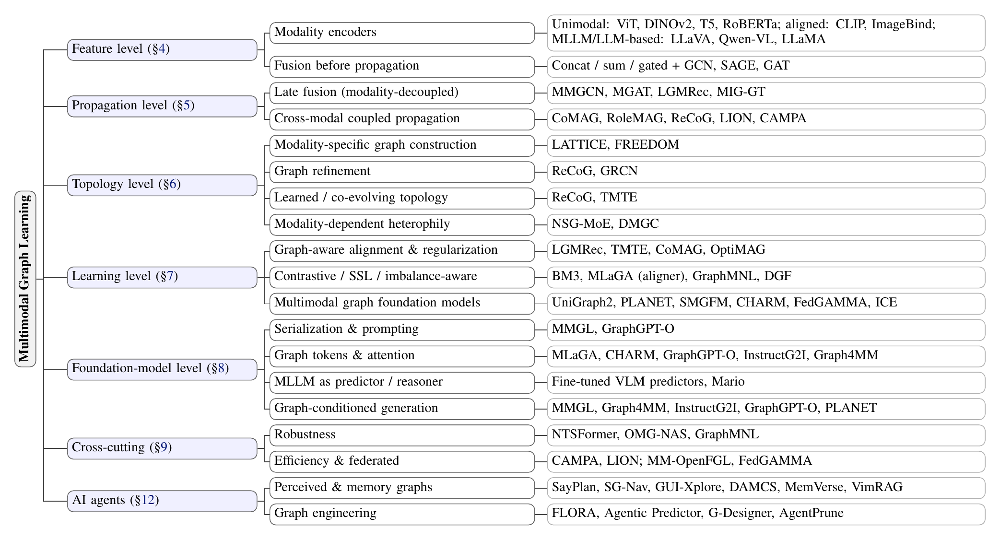

# Awesome Multimodal Graph Learning

[](https://awesome.re)
[](#contributing)

Companion repository for the survey

> **Multimodal Graph Learning: A Survey of Models, Benchmarks, and Frontiers**
> Rui Xue, Tianfu Wu

> Paper: https://arxiv.org/abs/2611.12990

Multimodal attributed graphs (MAGs), in which nodes carry text, images, and other modalities while edges encode relations among entities, underlie e-commerce, social media, content platforms, and creative applications. This repository collects the papers, benchmarks, and datasets covered by the survey, organized by the **integration level** at which multimodal information and graph structure meet: feature, propagation, topology, learning, and foundation model. It also covers cross-cutting issues (robustness, efficiency, federation) and connections to AI agents.

<p align="center">
  
</p>

Each entry lists the venue, a paper link, and a one-line summary. Methods may appear at more than one level; the full multi-label assignment is given in Table 2 of the survey. The list focuses on multimodal attributed graphs; multimodal knowledge graphs and agent workflow graphs are included only where they provide relevant background or methodological connections.

## Contents

- [Related Surveys](#related-surveys)
- [Feature Level: Encoders and Backbones](#feature-level-encoders-and-backbones)
- [Propagation Level](#propagation-level)
- [Topology Level](#topology-level)
- [Learning Level](#learning-level)
- [Foundation-Model Level](#foundation-model-level)
- [Cross-Cutting: Robustness, Efficiency, and Federation](#cross-cutting-robustness-efficiency-and-federation)
- [Benchmarks](#benchmarks)
- [Datasets](#datasets)
- [Official Benchmark Repositories](#official-benchmark-repositories)
- [Applications](#applications)
- [AI Agents](#ai-agents)
- [Citation](#citation)
- [Contributing](#contributing)

---

## Feature Level: Encoders and Backbones

Feature-level methods encode each modality, fuse the resulting embeddings (e.g., by concatenation, summation, or gating), and run a standard GNN. Encoders may be frozen or fine-tuned, depending on the evaluation protocol.

**Modality encoders**

| Family | Model | Venue | Link |
|---|---|---|---|
| Unimodal (vision) | ViT | ICLR 2021 | [[Paper]](https://arxiv.org/abs/2010.11929) |
| Unimodal (vision) | DINOv2 | arXiv 2023 | [[Paper]](https://arxiv.org/abs/2304.07193) |
| Unimodal (text) | T5 | JMLR 2020 | [[Paper]](https://arxiv.org/abs/1910.10683) |
| Unimodal (text) | RoBERTa | arXiv 2019 | [[Paper]](https://arxiv.org/abs/1907.11692) |
| Aligned | CLIP | ICML 2021 | [[Paper]](https://arxiv.org/abs/2103.00020) |
| Aligned | ImageBind | CVPR 2023 | [[Paper]](https://arxiv.org/abs/2305.05665) |
| MLLM | LLaVA | NeurIPS 2023 | [[Paper]](https://arxiv.org/abs/2304.08485) |
| MLLM | Qwen-VL | arXiv 2023 | [[Paper]](https://arxiv.org/abs/2308.12966) |
| LLM | LLaMA | arXiv 2023 | [[Paper]](https://arxiv.org/abs/2302.13971) |

**GNN backbones used as baselines**

| Model | Venue | Link |
|---|---|---|
| GCN | ICLR 2017 | [[Paper]](https://arxiv.org/abs/1609.02907) |
| GraphSAGE | NeurIPS 2017 | [[Paper]](https://arxiv.org/abs/1706.02216) |
| GAT | ICLR 2018 | [[Paper]](https://arxiv.org/abs/1710.10903) |
| BUDDY (link prediction) | ICLR 2023 | [[Paper]](https://arxiv.org/abs/2209.15486) |

---

## Propagation Level

### Modality-decoupled propagation with late fusion

- **MMGCN**: Multi-modal Graph Convolution Network for Personalized Recommendation of Micro-video. *ACM MM 2019*. [[Paper]](https://doi.org/10.1145/3343031.3351034)
  Runs a separate graph convolution per modality on the user–item graph and combines the modality-specific outputs at the end.
- **MGAT**: Multimodal Graph Attention Network for Recommendation. *Information Processing & Management 2020*. [[Paper]](https://doi.org/10.1016/j.ipm.2020.102277)
  Replaces uniform aggregation in each modality-specific graph with gated attention, then combines the modalities.
- **LGMRec**: Local and Global Graph Learning for Multimodal Recommendation. *AAAI 2024*. [[Paper]](https://arxiv.org/abs/2312.16400)
  Combines local modality-specific graph embeddings with modality-aware global hypergraph learning.
- **MIG-GT**: Modality-Independent Graph Neural Networks with Global Transformers for Multimodal Recommendation. *AAAI 2025*. [[Paper]](https://arxiv.org/abs/2412.13994)
  Gives each modality its own receptive field (per-modality GNN depth) and adds a sampling-based global transformer.

### Cross-modal coupled propagation

- **ReCoG**: Reciprocal Co-Evolution for Multimodal Graph Learning. *arXiv 2026*. [[Paper]](https://arxiv.org/abs/2608.22786)
  Couples text and vision streams through cross-modal neighbor aggregation on a refined graph and jointly trains the graph refiner; proves that modality-decoupled and late-fusion architectures with modality-local topology have no cross-modal dependency before fusion.
- **CoMAG**: Context-Aware Modality-Topology Co-Alignment for Multimodal Attributed Graphs. *arXiv 2026*. [[Paper]](https://arxiv.org/abs/2606.14172)
  Linear multi-hop coupled propagation over a reliability-aware context graph with task-conditioned coupling, plus hop-token alignment with a shared–private decomposition.
- **RoleMAG**: Learning Neighbor Roles in Multimodal Graphs. *arXiv 2026*. [[Paper]](https://arxiv.org/abs/2604.12271)
  Assigns each edge soft weights over shared, complementary, and heterophilous roles, routing each role through its own channel with directional top-K cross-modal completion.
- **CAMPA**: Efficient and Aligned Multimodal Graph Learning via Decoupled Propagation and Aggregation. *arXiv 2026*. [[Paper]](https://arxiv.org/abs/2605.11468)
  Adds a cross-modal neighbor term to precomputed multi-hop propagation and aligns hop features before trainable aggregation.
- **LION**: A Clifford Neural Paradigm for Multimodal-Attributed Graph Learning. *arXiv 2026*. [[Paper]](https://arxiv.org/abs/2601.21453)
  Represents a node's text and image features as one Clifford multivector so that propagation mixes the modalities.

---

## Topology Level

### Modality-specific graph construction

- **LATTICE**: Mining Latent Structures for Multimedia Recommendation. *ACM MM 2021*. [[Paper]](https://arxiv.org/abs/2104.09036)
  Learns modality-aware item–item graphs and combines them into a latent item graph for propagation.
- **FREEDOM**: A Tale of Two Graphs: Freezing and Denoising Graph Structures for Multimodal Recommendation. *ACM MM 2023*. [[Paper]](https://arxiv.org/abs/2211.06924)
  Freezes the item–item graph after construction and denoises the user–item graph by degree-sensitive edge pruning.

### Refining the observed graph

- **GRCN**: Graph-Refined Convolutional Network for Multimedia Recommendation with Implicit Feedback. *ACM MM 2020*. [[Paper]](https://arxiv.org/abs/2111.02036)
  Softly prunes observed user–item edges by the affinity between item content and routing-refined user-preference prototypes.
- **ReCoG** (see [Propagation Level](#cross-modal-coupled-propagation)): a cosine refiner and a learned residual refiner re-weight observed edges and recover missing ones from multimodal evidence.

### Learned and co-evolving topology

- **TMTE**: Effective Multimodal Graph Learning with Task-aware Modality and Topology Co-Evolution. *arXiv 2026*. [[Paper]](https://arxiv.org/abs/2603.27723)
  Learns task-adaptive topology from multi-perspective similarities over modality-specific and fused embeddings, with smoothness-regularized fused representations.
- **ReCoG** (see above): jointly optimizes the multimodal graph refiners with coupled cross-modal propagation.

General (unimodal) graph structure learning referenced in the survey:

- **IDGL**: Iterative Deep Graph Learning for Graph Neural Networks: Better and Robust Node Embeddings. *NeurIPS 2020*. [[Paper]](https://arxiv.org/abs/2006.13009)
- **Pro-GNN**: Graph Structure Learning for Robust Graph Neural Networks. *KDD 2020*. [[Paper]](https://arxiv.org/abs/2005.10203)
- **SLAPS**: Self-Supervision Improves Structure Learning for Graph Neural Networks. *NeurIPS 2021*. [[Paper]](https://arxiv.org/abs/2102.05034)
- **NodeFormer**: A Scalable Graph Structure Learning Transformer for Node Classification. *NeurIPS 2022*. [[Paper]](https://arxiv.org/abs/2306.08385)

### Modality-dependent heterophily

- **NSG-MoE**: Modality as Heterogeneity: Node Splitting and Graph Rewiring for Multimodal Graph Learning. *arXiv 2026*. [[Paper]](https://arxiv.org/abs/2602.00067)
  Splits each node into modality-specific components, rewires the graph into within- and cross-modality relations, and assigns relation-aware experts.
- **DMGC**: Disentangling Homophily and Heterophily in Multimodal Graph Clustering. *ACM MM 2025*. [[Paper]](https://arxiv.org/abs/2507.15253)
  Builds a cross-modal consensus graph and modality-specific heterophily-aware graphs with low-pass and high-pass filters for clustering.

---

## Learning Level

### Graph-aware alignment and regularization

- **OptiMAG**: Structure-Semantic Alignment via Unbalanced Optimal Transport. *arXiv 2026*. [[Paper]](https://arxiv.org/abs/2601.22856)
  A plug-in unbalanced optimal transport regularizer based on fused Gromov–Wasserstein distance that encourages consistency between modality-specific semantic structures and topology.
- **LGMRec**, **TMTE**, **CoMAG** (see above): contrast hypergraph embeddings across modalities, align modality and fused embeddings over the evolving topology, and match graph-contextualized modality pairs, respectively.

### Contrastive, self-supervised, and imbalance-aware objectives

- **BM3**: Bootstrap Latent Representations for Multi-modal Recommendation. *WWW 2023*. [[Paper]](https://arxiv.org/abs/2207.05969)
  Generates latent views by dropout with a stop-gradient target, avoiding negative samples and graph augmentation.
- **GraphMNL**: Multimodal Graph Negative Learning. *arXiv 2026*. [[Paper]](https://arxiv.org/abs/2606.12863)
  Scores per-node branch reliability and applies reliability-controlled negative learning instead of forcing weaker branches to imitate the dominant one.
- **DGF**: Cross-Contrastive Clustering for Multimodal Attributed Graphs with Dual Graph Filtering. *KDD 2026*. [[Paper]](https://arxiv.org/abs/2511.20030)
  Combines node-domain and feature-domain graph filters with a tri-cross contrastive objective over modalities, neighborhoods, and communities.
- **MLaGA** (aligner; see [Foundation-Model Level](#graph-tokens-and-graph-aware-attention)): pretrains a structure-aware multimodal aligner with a graph contrastive objective.

### Multimodal graph foundation models

- **UniGraph2**: Learning a Unified Embedding Space to Bind Multimodal Graphs. *WWW 2025*. [[Paper]](https://arxiv.org/abs/2502.00806)
  Frozen modality encoders with mixture-of-experts alignment across modalities and domains, pretrained by masked feature and structure reconstruction.
- **PLANET**: Toward Effective Multimodal Graph Foundation Model: A Divide-and-Conquer Based Approach. *ICML 2026*. [[Paper]](https://arxiv.org/abs/2602.04116)
  Separates local interaction (embedding-wise domain gating) from global alignment (node-wise discretization into a shared semantic space).
- **SMGFM**: Spectral Multimodal Graph Pretraining for Multimodal-Attributed Graphs. *arXiv 2026*. [[Paper]](https://arxiv.org/abs/2606.12867)
  Decomposes modality signals into graph-frequency bands, aligning low-frequency consensus while preserving high-frequency modality-specific evidence.
- **CHARM**: A Multimodal Graph Foundation Model with Hierarchical Context Modeling for Zero-Shot Transfer. *arXiv 2026*. [[Paper]](https://arxiv.org/abs/2607.26023)
  Encodes retrieved hierarchical and modality-complementary context as graph tokens for a frozen LLM, targeting zero-shot transfer to unseen graphs.
- **FedGAMMA**: Toward Federated Multimodal Graph Foundation Models: A Topology-Aware Multimodal Alignment Framework. *arXiv 2026*. [[Paper]](https://arxiv.org/abs/2607.15687)
  Extends multimodal graph foundation learning to federated clients with optimal-transport alignment, topology-aware fusion, and prompt-based adaptation.
- **ICE**: Task-Aligned Clifford Latent Fields for Multimodal Graph Foundation Models. *arXiv 2026*. [[Paper]](https://arxiv.org/abs/2609.29398)
  Encodes topology, text, and images in a node-indexed Clifford latent field with a single shared model and task-specific node and link heads.

---

## Foundation-Model Level

### Graph serialization and prompting

- **MMGL**: Multimodal Graph Learning for Generative Tasks. *arXiv 2023*. [[Paper]](https://arxiv.org/abs/2310.07478)
  Studies how pretrained language models use multiple multimodal neighbors for Wikipedia section summarization, comparing neighbor encodings, structure encodings, and parameter-efficient adaptation.
- **GraphGPT-O**: Synergistic Multimodal Comprehension and Generation on Graphs. *CVPR 2025*. [[Paper]](https://arxiv.org/abs/2502.11925)
  Compares neighborhood linearizations for an MLLM, introduces a hierarchical Q-Former aligner, and generates both the text and the image of a node.

### Graph tokens and graph-aware attention

- **MLaGA**: Multimodal Large Language and Graph Assistant. *KDD 2026*. [[Paper]](https://arxiv.org/abs/2506.02568)
  Pretrains a structure-aware multimodal aligner, then projects its representations into the token space of a frozen LLM for node classification and link prediction.
- **Graph4MM**: Weaving Multimodal Learning with Structural Information. *ICML 2025*. [[Paper]](https://arxiv.org/abs/2510.16990)
  Hop-Diffused Attention incorporates multi-hop graph structure into attention, while an MM-QFormer extracts text-conditioned visual features.
- **CHARM**, **GraphGPT-O**, **InstructG2I**: graph tokens from retrieved contexts, node-/graph-level Q-Formers, and a Graph-QFormer for image diffusion, respectively.

### MLLMs as predictors and reasoners

- **GraphVLM**: Benchmarking Vision Language Models for Multimodal Graph Learning. *CVPR 2026*. [[Paper]](https://arxiv.org/abs/2603.13370)
  Organizes VLM use on MAGs into VLM-as-Encoder, -Aligner, and -Predictor; fine-tuned VLM predictors are strong even without explicit structure.
- **Mario**: Multimodal Graph Reasoning with Large Language Models. *CVPR 2026*. [[Paper]](https://arxiv.org/abs/2603.05181)
  Trains a graph-conditioned VLM with a topology-aware mixer, then instruction-tunes an LLM with a router that picks a text-only, image-only, or multimodal view per node.

### Graph-conditioned generation

- **InstructG2I**: Synthesizing Images from Multimodal Attributed Graphs. *NeurIPS 2024*. [[Paper]](https://arxiv.org/abs/2410.07157)
  Selects neighbors by personalized PageRank and semantic re-ranking, encodes them with a Graph-QFormer, and controls generation with graph classifier-free guidance.
- **MMGL**, **Graph4MM** (graph-to-text), **GraphGPT-O** (text and image), and **PLANET** (as a representation provider for existing generation pipelines); see above.
- **Classifier-Free Diffusion Guidance**. *arXiv 2022*. [[Paper]](https://arxiv.org/abs/2207.12598)
  Background for graph-conditioned guidance.

---

## Cross-Cutting: Robustness, Efficiency, and Federation

### Robustness

- **NTSFormer**: A Self-Teaching Graph Transformer for Multimodal Isolated Cold-Start Node Classification. *AAAI 2026*. [[Paper]](https://arxiv.org/abs/2507.04870)
  A cold-start attention mask lets one model produce a self-only student prediction and a self-plus-neighbor teacher prediction for isolated nodes with missing modalities.
- **OMG-NAS**: Multimodal Graph Neural Architecture Search under Distribution Shifts. *AAAI 2024*. [[Paper]](https://ojs.aaai.org/index.php/AAAI/article/view/28663)
  Searches over GNN, fusion, and prediction operators while learning sample weights that decorrelate unimodal and cross-modal features.
- **GraphMNL** (see [Learning Level](#contrastive-self-supervised-and-imbalance-aware-objectives)).

### Efficiency

- **CAMPA**, **LION** (see [Propagation Level](#cross-modal-coupled-propagation)): precompute multi-hop propagation once so that only aggregation is trained.

### Federated learning

- **MM-OpenFGL**: A Comprehensive Benchmark for Multimodal Federated Graph Learning. *arXiv 2026*. [[Paper]](https://arxiv.org/abs/2601.22416)
  19 datasets across 7 domains, 8 federation simulation strategies, 57 methods, and 6 downstream tasks.
- **FedGAMMA** (see [Learning Level](#multimodal-graph-foundation-models)).

---

## Benchmarks

| Benchmark | Venue | #Datasets | Graph-centric tasks | Modality-centric tasks | Link |
|---|---|---|---|---|---|
| MM-GRAPH: Mosaic of Modalities | CVPR 2025 | 7 | NC, LP, KGC | – | [[Paper]](https://arxiv.org/abs/2406.16321) |
| MAGB: When Graph meets Multimodal | KDD 2025 | 5 | NC (GNN and zero-shot VLM predictors) | – | [[Paper]](https://arxiv.org/abs/2410.09132) |
| GraphVLM | CVPR 2026 | 6 | NC, including cross-dataset transfer | – | [[Paper]](https://arxiv.org/abs/2603.13370) |
| OpenMAG | ICML 2026 | 19 | NC, LP, Clustering | Matching, Retrieval, Alignment, G2Text, G2Image | [[Paper]](https://arxiv.org/abs/2602.05576) |
| MM-OpenFGL | arXiv 2026 | 19 | 6 federated downstream tasks | – | [[Paper]](https://arxiv.org/abs/2601.22416) |

NC: node classification; LP: link prediction; KGC: knowledge-graph completion; G2Text/G2Image: graph-conditioned text/image generation.

---

## Datasets

Statistics as reported by the source benchmark (edge counts follow each source's convention).

| Dataset | Source | Domain | \|V\| | \|E\| | #Classes | Task | Metrics |
|---|---|---|---:|---:|---:|---|---|
| Ele-fashion | MM-GRAPH | Products | 97,766 | 199,602 | 12 | NC | Acc, F1 |
| Goodreads-NC | MM-GRAPH | Books | 685,294 | 7,235,084 | 10 | NC | Acc, F1 |
| Amazon-Sports | MM-GRAPH | Products | 50,250 | 356,202 | – | LP | MRR, Hits@K |
| Amazon-Cloth | MM-GRAPH | Products | 125,839 | 951,271 | – | LP | MRR, Hits@K |
| Goodreads-LP | MM-GRAPH | Books | 636,502 | 3,437,017 | – | LP | MRR, Hits@K |
| MM-CoDEx-s | MM-GRAPH | MMKG | 1,383 | 15,884 | – | KGC | MRR, Hits@K |
| MM-CoDEx-m | MM-GRAPH | MMKG | 7,697 | 52,840 | – | KGC | MRR, Hits@K |
| Movies | MAGB / OpenMAG | Products | 16,672 | 218,390 | 20 | NC | Acc, F1 |
| Toys | MAGB / OpenMAG | Products | 20,695 | 126,886 | 18 | NC, Clustering | Acc, F1; NMI, ARI |
| Grocery | MAGB / OpenMAG | Products | 17,074 | 171,340 | 20 | NC | Acc, F1 |
| Reddit-S | MAGB / OpenMAG | Social | 15,894 | 566,160 | 20 | NC, Clustering | Acc, F1; NMI, ARI |
| Reddit-M | MAGB | Social | 99,638 | 1,167,188 | 50 | NC | Acc, F1 |
| DY | OpenMAG | Video | 8,299 | 35,627 | – | LP | MRR, Hits@K |
| KU | OpenMAG | Video | 5,370 | 22,052 | – | LP | MRR, Hits@K |
| Bili dance | OpenMAG | Video | 2,307 | 9,127 | – | LP | MRR, Hits@K |
| Flickr30k | OpenMAG | Image–text | 31,783 | 181,151 | – | G2Text | BLEU, ROUGE-L, CIDEr |
| SemArt | OpenMAG | Art | 21,382 | 1,216,432 | – | G2Image | CLIP, DINOv2 |
| ART500K | InstructG2I | Art | 311,288 | 643,008,344 | – | G2Image | CLIP, DINOv2, FID |
| Amazon (Beauty) | InstructG2I | Products | 178,890 | 3,131,949 | – | G2Image | CLIP, DINOv2, FID |
| Goodreads (Mystery) | InstructG2I | Books | 93,475 | 637,210 | – | G2Image | CLIP, DINOv2, FID |

**Encoder-independent dataset descriptors** (survey Section 10.3): label homophily $h_y$, average degree $\bar d = 2|E|/|V|$ on distinct undirected edges, average local clustering coefficient (CC), and transitivity (Tr). MM-GRAPH values are as reported; MAGB values are computed on the released graphs with the same definitions.

| Dataset | Source | $h_y$ | $\bar d$ | CC | Tr |
|---|---|---:|---:|---:|---:|
| Movies | MAGB | 0.4470 | 9.65 | 0.3442 | 0.2584 |
| Toys | MAGB | 0.7241 | 5.48 | 0.2398 | 0.1908 |
| Grocery | MAGB | 0.6813 | 8.33 | 0.3071 | 0.1445 |
| Reddit-S | MAGB | 0.9585 | 17.81 | 0.6993 | 1.0000 |
| Reddit-M | MAGB | 0.6716 | 5.86 | 0.5762 | 1.0000 |
| Ele-fashion | MM-GRAPH | 0.7675 | 4.08 | 0.1730 | 0.0560 |
| Goodreads-NC | MM-GRAPH | 0.6667 | 21.11 | 0.1614 | 0.0498 |
| Amazon-Sports | MM-GRAPH | N/A | 14.18 | 0.4002 | 0.2658 |
| Amazon-Cloth | MM-GRAPH | N/A | 15.12 | 0.2940 | 0.1846 |
| Goodreads-LP | MM-GRAPH | N/A | 10.79 | 0.1102 | 0.0348 |

---

## Official Benchmark Repositories

These are the original authors' code or data repositories, not implementations maintained by this survey.

| Benchmark | Code / data | Notes |
|---|---|---|
| MM-GRAPH | [Project page](https://mm-graph-benchmark.github.io/) · [Code](https://github.com/mm-graph-benchmark/mm-graph-benchmark) · [Dataset](https://huggingface.co/datasets/mm-graph-org/mm-graph) | Original benchmark, features, and preprocessing |
| MAGB | [Official code](https://github.com/sktsherlock/MAGB) | Dataset and evaluation pipeline |
| GraphVLM | [Official code](https://github.com/oamyjin/GraphVLM) | VLM-as-Encoder, -Aligner, and -Predictor pipelines |
| OpenMAG | [Code (link given in the paper)](https://anonymous.4open.science/r/OpenMAG-F703/) | Encoders, model library, and evaluation workflows |

For cross-paper comparisons, check the original split, encoder, negative sampling, and evaluation protocol before reusing reported results.

---

## Applications

Beyond recommendation (see the propagation and topology sections above):

- **C-MAG**: Cascade Multimodal Attributed Graphs for Supply Chain Link Prediction. *arXiv 2025*. [[Paper]](https://arxiv.org/abs/2508.08071)
  Predicts which manufacturers can make which products through a two-stage cascade of multimodal graphs.
- **M³KG-RAG**: Multi-hop Multimodal Knowledge Graph-enhanced Retrieval-Augmented Generation. *CVPR 2026*. [[Paper]](https://arxiv.org/abs/2512.20136)
  Multi-hop retrieval over multimodal knowledge graphs for retrieval-augmented generation.
- **Scene-Driven Multimodal Knowledge Graph Construction for Embodied AI**. *IEEE TKDE 2024*. [[Paper]](https://arxiv.org/abs/2311.03783)
  Enriches embodied scene graphs with multimodal semantic attributes.

---

## AI Agents

### Multimodal graphs for agent perception and memory

- **SayPlan**: Grounding Large Language Models using 3D Scene Graphs for Scalable Robot Task Planning. *CoRL 2023*. [[Paper]](https://arxiv.org/abs/2307.06135)
  Grounds LLM task planning in 3D scene graphs of objects and spatial relations.
- **SG-Nav**: Online 3D Scene Graph Prompting for LLM-based Zero-shot Object Navigation. *NeurIPS 2024*. [[Paper]](https://arxiv.org/abs/2410.08189)
  Prompts an LLM with an online 3D scene graph for zero-shot object navigation.
- **GUI-Xplore**: Empowering Generalizable GUI Agents with One Exploration. *CVPR 2025*. [[Paper]](https://arxiv.org/abs/2503.17709)
  Represents GUI navigation and interface transitions as graphs.
- **DAMCS**: LLM-Powered Decentralized Generative Agents with Adaptive Hierarchical Knowledge Graph for Cooperative Planning. *arXiv 2025*. [[Paper]](https://arxiv.org/abs/2502.05453)
  Organizes agent experience in an adaptive hierarchical knowledge graph for cooperative planning.
- **MemVerse**: Multimodal Memory for Lifelong Learning Agents. *arXiv 2025*. [[Paper]](https://arxiv.org/abs/2512.03627)
  Multimodal memory for lifelong learning agents.
- **VimRAG**: Navigating Massive Visual Context in Retrieval-Augmented Generation via Multimodal Memory Graph. *ICML 2026*. [[Paper]](https://arxiv.org/abs/2602.12735)
  Builds a dynamic multimodal memory graph and allocates visual tokens according to the topological roles of memory nodes.

### Graph engineering: workflow and communication graphs

- **FLORA**: GNNs as Predictors of Agentic Workflow Performances. *arXiv 2025*. [[Paper]](https://arxiv.org/abs/2503.11301)
  Predicts workflow performance with GNNs over prompt-derived node features.
- **Agentic Predictor**: Multi-View Encoders for Performance Prediction in LLM-Based Agentic Workflows. *ICLR 2026*. [[Paper]](https://arxiv.org/abs/2505.19764)
  Encodes prompts, code, and operator information as multiple views over a shared workflow topology with cross-view attention.
- **G-Designer**: Architecting Multi-agent Communication Topologies via Graph Neural Networks. *ICML 2025*. [[Paper]](https://arxiv.org/abs/2410.11782)
  Uses a GNN to design task-adaptive multi-agent communication topologies.
- **AgentPrune**: Cut the Crap: An Economical Communication Pipeline for LLM-based Multi-Agent Systems. *ICLR 2025*. [[Paper]](https://arxiv.org/abs/2410.02506)
  Prunes redundant communication edges in multi-agent systems.

---

## Citation

If you find this survey or repository useful, please cite:

```bibtex
@misc{xue2026mglsurvey,
  title   = {Multimodal Graph Learning: A Survey of Models, Benchmarks, and Frontiers},
  author  = {Xue, Rui and Wu, Tianfu},
  note    = {Preprint; arXiv identifier to be added},
  year    = {2026}
}
```

## Contributing

Pull requests are welcome. To add a paper, please follow the existing format:

```markdown
- **Name**: Paper Title. *Venue Year*. [[Paper]](link) [[Code]](link)
  One-sentence summary of the method.
```

and place it under the integration level of its primary contribution. Please open an issue for corrections to venues, links, or dataset statistics. Include a primary source for factual corrections (official proceedings, paper, or dataset release) and specify whether results come from the original benchmark or a later study.

### Reproducibility and maintenance

Dataset-level numbers in the tables above are descriptive statistics, not model-performance results. Raw edge counts follow each source's convention. The descriptors computed in this repository use the released graphs converted to simple undirected graphs (self-loops and duplicate edges removed), with label homophily computed on these edges. Results obtained under different splits, encoders, or negative-sampling protocols should not be merged into a single leaderboard.
